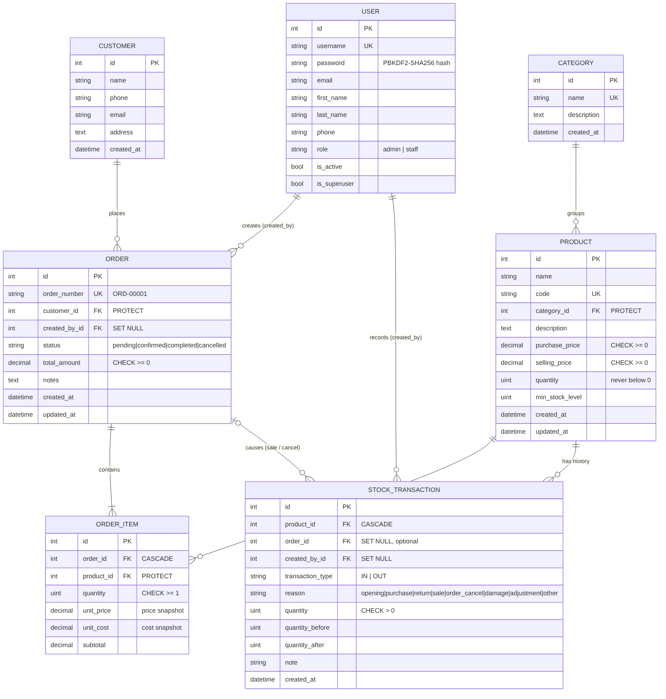

# Smart Inventory & Order Management System

A full-stack inventory and order management system: **Django + Django REST Framework + SQLite** backend,
**Bootstrap 5** web dashboard, and a **Kotlin Android** client that talks to the REST API.
Built as a Full Stack Developer Internship technical assessment.

> **Honest status summary** (details in [Known limitations](#known-limitations--incomplete-items)):
> the backend, web UI and REST API are implemented and tested (72 automated tests + live HTTP and real-browser tests).
> The Android app is fully written and its API contract was verified against the live server, but it was
> **not compiled or run** (no Android SDK was available where this project was built) – you must open it in Android Studio.

---

## Contents
1. [Features](#features) · 2. [Technology](#technology) · 3. [Folder structure](#folder-structure)
4. [Quick start on Windows (PowerShell)](#quick-start-on-windows-powershell) · 5. [Login credentials](#default-login-credentials-local-testing-only)
6. [Database structure & ER diagram](#database-structure) · 7. [REST API & Swagger](#rest-api) · 8. [Android app](#android-app)
9. [Testing](#testing) · 10. [Deployment](#deployment) · 11. [Git / GitHub](#git--github) · 12. [Known limitations](#known-limitations--incomplete-items)

## Features

| Module | What you get |
|---|---|
| **Authentication** | Login, logout, registration (creates *Staff*), Admin and Staff roles, role-based access control, PBKDF2-SHA256 password hashing, password validators, every page protected |
| **Dashboard** | Total products / customers / orders / sales, low-stock alert banner, sales today / this month / gross profit, 7-day sales chart, orders-by-status chart, inventory value & stock by category, top-selling products, recent orders, low-stock list – **all computed live from the database** |
| **Products** | Add / view / edit / delete, search, filter by category and stock status, categories CRUD, unique product code, price validation (selling ≥ purchase) |
| **Inventory** | Stock In, Stock Out, current stock, full stock history (before/after, reason, user, linked order), automatic updates, low-stock notifications, validation, **negative stock impossible** |
| **Customers** | Add / view / edit / delete (admin), search; customers with orders are protected from deletion |
| **Orders** | Select customer, add many products with quantities, live subtotal and grand total, **automatic stock reduction**, blocked when stock is insufficient, order history with filters, details, status (pending → confirmed → completed / cancelled; cancelling restores stock). Everything runs inside a database transaction |
| **Reports** | Daily, Monthly, Total sales, Inventory, Low stock, Orders – each printable (Print button + print stylesheet; use *Save as PDF* in the print dialog) |
| **REST API** | Token auth, serializers, viewsets, permissions, validation, correct HTTP status codes, uniform error format, pagination, search/filter, Swagger UI + ReDoc + OpenAPI file |
| **Android** | Login, Dashboard, Products, Stock, Customers, Create order, Orders list/details/status |
| **UI/UX** | Sidebar, top bar, stat cards, modern tables, search & filters, responsive (works on phones), Bootstrap Icons, works fully **offline** (no CDN) |

### Roles
| | Admin | Staff |
|---|---|---|
| Create / edit products, customers, stock, orders | ✔ | ✔ |
| **Delete** products, categories, customers | ✔ | ✘ (403) |
| User management (`/users/`), Django admin | ✔ | ✘ (403) |

## Technology
Python 3.10–3.13 · Django 5.2 LTS · Django REST Framework 3.16 · drf-spectacular (Swagger) · SQLite · WhiteNoise ·
HTML / CSS / Bootstrap 5 / vanilla JavaScript / Chart.js (all bundled locally) · Kotlin, Material 3, Retrofit, OkHttp, Coroutines · Git.

## Folder structure
```
SmartInventory/
├── backend/
│   ├── manage.py
│   ├── requirements.txt            # dependencies (Windows friendly)
│   ├── requirements-prod.txt       # + gunicorn for Linux hosting
│   ├── db.sqlite3                  # ready-to-use database: migrated + sample data
│   ├── config/                     # settings (env driven), urls, wsgi/asgi
│   ├── core/                       # dashboard, shared helpers, `seed_data` command
│   ├── accounts/ products/ inventory/ customers/ orders/ reports/   # Django apps (models, views, forms, services, migrations, tests)
│   ├── api/                        # REST API: serializers, viewsets, permissions, urls, tests
│   ├── templates/                  # HTML templates (Bootstrap 5)
│   ├── static/                     # css/, js/, vendor/ (Bootstrap, icons, Chart.js – local)
│   └── live_tests/                 # optional live HTTP + real-browser tests
├── android/SmartInventoryAndroid/  # Android Studio project (Kotlin) + its own README
├── documentation/
│   ├── ER_Diagram/                 # er_diagram.png / .svg / .mmd (source)
│   ├── API_Documentation/          # API_Reference.md, openapi.yaml, openapi.json
│   └── Project_Documentation/      # architecture, design decisions, feature map
├── setup.ps1  run.ps1  test.ps1    # Windows helper scripts
├── Procfile  render.yaml           # deployment configuration
├── .env.example  .gitignore  README.md
```

## Quick start on Windows (PowerShell)

**Prerequisites:** Windows 10/11, **Python 3.10 – 3.13** from <https://www.python.org/downloads/>
(tick **“Add python.exe to PATH”** and keep the *py launcher*), and Visual Studio Code with the *Python* extension.
Check: `py --version`

1. Extract the ZIP, then in VS Code: **File ▸ Open Folder…** → the `SmartInventory` folder → **Terminal ▸ New Terminal** (PowerShell).

### Option A – one command
```powershell
Set-ExecutionPolicy -Scope Process -ExecutionPolicy RemoteSigned   # only affects this terminal window
.\setup.ps1      # creates .venv, installs requirements, migrates, loads sample data
.\run.ps1        # starts http://127.0.0.1:8000/
```

### Option B – step by step (identical result)
```powershell
cd backend
py -m venv .venv
.\.venv\Scripts\Activate.ps1
python -m pip install --upgrade pip
pip install -r requirements.txt

python manage.py migrate            # creates/updates tables (db.sqlite3 already included, so this is quick)
python manage.py seed_data          # sample categories, products, customers, orders + admin & staff users
# python manage.py createsuperuser  # optional: create your own admin

python manage.py runserver
```
Open **<http://127.0.0.1:8000/>** and sign in. (In VS Code choose the interpreter `backend\.venv\Scripts\python.exe` via *Ctrl+Shift+P ▸ Python: Select Interpreter*.)

To start from a blank database instead of sample data: delete `backend\db.sqlite3`, run `python manage.py migrate`, then `python manage.py createsuperuser`.

| URL | Page |
|---|---|
| <http://127.0.0.1:8000/> | Dashboard (web app) |
| <http://127.0.0.1:8000/api/docs/> | **Swagger UI** |
| <http://127.0.0.1:8000/api/redoc/> | ReDoc |
| <http://127.0.0.1:8000/admin/> | Django admin (admin only) |

### Default login credentials (local testing only)
| Role | Username | Password |
|---|---|---|
| Admin | `admin` | `Admin@12345` |
| Staff | `staff` | `Staff@12345` |

These are created by `seed_data` for local testing. **Change or remove them before any real deployment.**

### Environment variables (optional locally)
Copy `.env.example` to `backend\.env` and edit. Defaults work for local development. No secrets are committed;
with `DJANGO_DEBUG=False` the app refuses to start unless a real `DJANGO_SECRET_KEY` is set.

## Database structure
SQLite, 7 models – `User`, `Category`, `Product`, `Customer`, `Order`, `OrderItem`, `StockTransaction` –
with foreign keys (`PROTECT` where history must be preserved), unique constraints (product code, order number,
one line per product per order) and `CHECK` constraints (prices ≥ 0, quantities > 0, stock ≥ 0).



Source: `documentation/ER_Diagram/er_diagram.mmd` (Mermaid). Design notes: `documentation/Project_Documentation/Project_Documentation.md`.

## REST API
Base URL `http://127.0.0.1:8000/api/` · Token authentication: `Authorization: Token <key>` · Full reference:
[`documentation/API_Documentation/API_Reference.md`](documentation/API_Documentation/API_Reference.md) · Interactive: **/api/docs/**.

| Area | Endpoints |
|---|---|
| Auth | `POST auth/login/` · `POST auth/register/` · `POST auth/logout/` · `GET auth/me/` |
| Products | `/products/` (CRUD, `?search=&category=&status=`) · Categories `/categories/` |
| Customers | `/customers/` (CRUD, `?search=`) |
| Inventory | `GET inventory/stock/` · `GET inventory/low-stock/` · `GET inventory/transactions/` · `POST inventory/stock-in/` · `POST inventory/stock-out/` |
| Orders | `/orders/` (list, detail, create) · `POST orders/{id}/status/` |
| Dashboard | `GET dashboard/` |
| Reports | `reports/daily/` · `monthly/` · `total-sales/` · `inventory/` · `low-stock/` · `orders/` |

### Test the API from PowerShell
```powershell
$login = Invoke-RestMethod -Method Post -Uri http://127.0.0.1:8000/api/auth/login/ `
         -ContentType "application/json" -Body '{"username":"admin","password":"Admin@12345"}'
$h = @{ Authorization = "Token $($login.token)" }

Invoke-RestMethod -Uri http://127.0.0.1:8000/api/dashboard/ -Headers $h
(Invoke-RestMethod -Uri "http://127.0.0.1:8000/api/products/?search=mouse" -Headers $h).results

Invoke-RestMethod -Method Post -Uri http://127.0.0.1:8000/api/orders/ -Headers $h -ContentType "application/json" `
   -Body '{"customer":1,"items":[{"product":2,"quantity":1}]}'
```
Or open **/api/docs/**, click **Authorize**, enter `Token <your-token>` and try endpoints in the browser.

## Android app
Location: `android/SmartInventoryAndroid/` (detailed guide in its own `README.md`).

1. Install **Android Studio** (Koala 2024.1+ recommended; includes the JDK).
2. **File ▸ Open** → `android\SmartInventoryAndroid`. Let Gradle sync (needs internet the first time) and accept the SDK 34 install prompt.
3. Start the backend so the phone/emulator can reach it:
   ```powershell
   cd backend
   .\.venv\Scripts\Activate.ps1
   python manage.py runserver 0.0.0.0:8000
   ```
4. Run the app on an emulator (default server URL `http://10.0.2.2:8000/` works as-is) and sign in with `admin` / `Admin@12345`.
5. **Real phone** (same Wi-Fi): run `ipconfig`, note your IPv4 address (e.g. `192.168.1.10`), add it to `DJANGO_ALLOWED_HOSTS` in `backend\.env`, restart the server, allow Python through Windows Firewall, and type `http://192.168.1.10:8000/` in the app's *Server URL* field.

## Testing
```powershell
cd backend
.\.venv\Scripts\Activate.ps1
python manage.py test            # or: ..\test.ps1  (verbose)
```
**72 automated tests** cover: login/logout/registration/password hashing, role-based permissions (web and API), product / category / customer CRUD
(including customer deletion rules), stock in/out, negative-stock prevention, low-stock alerts, order creation with several products,
price snapshots, atomic rollback when stock is insufficient, cancellation restoring stock, all reports, dashboard figures, every API endpoint
(status codes, validation, auth, pagination, search) and Swagger availability.

Optional **live tests** against a running server (see `backend/live_tests/README.md`): an HTTP script (58 checks, web forms + REST API) and a
real-Chromium browser script (52 checks: login, product/customer/stock/order workflows via the actual UI, customer deletion, live order total,
stock reduction verified in the database, reports + print, RBAC, registration, responsive layout, no JS errors).

### What was verified (and how)
| Check | Result |
|---|---|
| `python manage.py test` (Linux, Python 3.13, Django 5.2.19) | 72 / 72 pass |
| Live HTTP + API script | 58 / 58 pass |
| Real browser (Chromium via Playwright) UI script | 52 / 52 pass |
| OpenAPI schema generation with `--validate` | No errors or warnings |
| Android JSON models vs. real API responses (static contract check) | 157 of 160 mappings match; the other 3 (`low_stock_alerts` on non-create responses) are optional fields with Kotlin defaults |
| Android app compiled / run on a device | **NOT done** – see limitations |

## Deployment
Configuration is provided (`Procfile`, `render.yaml`, `requirements-prod.txt`, WhiteNoise for static files, environment-based settings) but a real
deployment was **not performed** during development.

1. Push the repo to GitHub. Create a *Web Service* on Render / Railway / similar from the `backend` folder.
2. Build: `pip install -r requirements-prod.txt && python manage.py collectstatic --noinput`
3. Start: `python manage.py migrate --noinput && gunicorn config.wsgi:application`
4. Set environment variables: `DJANGO_DEBUG=False`, `DJANGO_SECRET_KEY=<random>`, `DJANGO_ALLOWED_HOSTS=<your-domain>`,
   `DJANGO_CSRF_TRUSTED_ORIGINS=https://<your-domain>` (generate a key: `python -c "from django.core.management.utils import get_random_secret_key as k; print(k())"`).
5. Create the first admin: `python manage.py createsuperuser` (do **not** run `seed_data` in production).
6. **Database:** SQLite is fine for demos, but most free hosts wipe the disk on every deploy. For production attach a persistent disk and set
   `DJANGO_DB_PATH`, or switch `DATABASES` to PostgreSQL. Migrations are applied with `python manage.py migrate` (back up first: copy `db.sqlite3`).
7. **Android in production:** point the app's Server URL at your `https://` domain and remove `android:usesCleartextTraffic="true"` from the manifest.

## Git / GitHub
```powershell
git init
git add .
git commit -m "Smart Inventory & Order Management System"
git branch -M main
git remote add origin https://github.com/<your-username>/<repo>.git
git push -u origin main
```
`.gitignore` already excludes `.env`, virtual environments, `db.sqlite3`, build folders. Never commit real secrets.

## Known limitations / incomplete items
Please read this before demonstrating the project.

1. **Android app is untested.** The Kotlin code was written and statically cross-checked (resource IDs, view-binding names, JSON field names/types against the live API), but it was never compiled, run on an emulator, or tested on a phone, because no Android SDK was available. Expect that you may need to fix small build issues on first Gradle sync. The *API side* it depends on is tested.
2. **Not tested on Windows.** All testing ran on Linux. The Python code is OS-independent and the PowerShell scripts (`setup.ps1`, `run.ps1`, `test.ps1`) use standard commands, but they have not been executed on a Windows machine.
3. **Browser coverage:** UI testing used Chromium only (not Edge, Firefox or Safari).
4. **Android scope:** lists show up to 200 rows (search narrows them); stock in/out, product/customer create/edit and reports are web-only. Token is kept in `SharedPreferences` (not Keystore); no automated Android tests.
5. **Reports** are printable (browser print / Save as PDF); there is **no CSV/Excel export**.
6. **Not implemented:** password reset by email, email/SMS notifications (low-stock notifications are on-screen alerts and API responses), multi-warehouse stock, taxes/discounts/invoices, order editing after creation (orders are cancelled instead).
7. **Deployment files are untested** against a real host; SQLite is not suited to heavy concurrent production use.
8. **Demo credentials** (`admin`, `staff`) and the included `db.sqlite3` with sample data are for local testing only.
